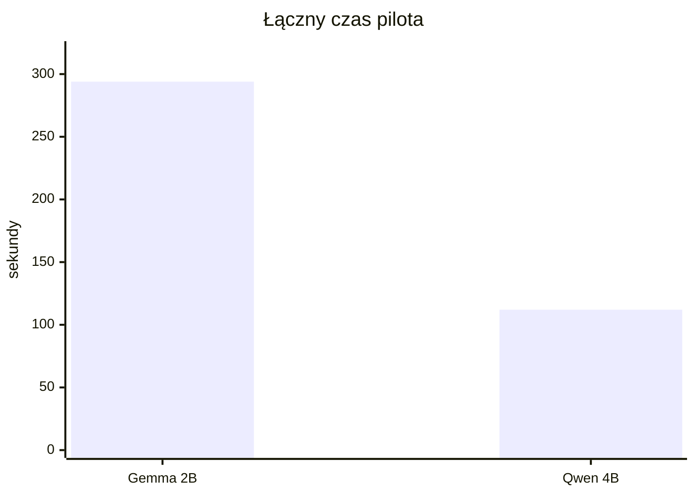

# Raport z pilota atrybucji Shapleya

## Kontekst i zakres

Pierwszy etap projektu badał, jak fragmenty promptu wpływają na wynik generatora LC/NC. Ten pilot rozszerza podejście na cztery domeny: prompt-to-feature, inżynierię wymagań, projekt architektury i generowanie testów. System agentowy z TODO pozostaje poza zakresem; wymaga osobnego mechanizmu odtwarzania stanu repozytorium dla każdej koalicji.

Wspólny silnik w [`lcnc.py`](./lcnc.py) oblicza dokładne wartości Shapleya albo, po podaniu `--samples N`, ich estymację próbkowaną. Domeny dostarczają własne generatory i ewaluatory. Runner [`run_domain_experiment.py`](./run_domain_experiment.py) uruchamia każdą domenę. W pilocie każdy prompt zawierał trzy zidentyfikowane fragmenty (`P1`–`P3`), czyli osiem koalicji w dokładnym trybie. Wyniki to wkłady do kryteriów ewaluatora, a nie ogólna ocena jakości ani dowód przyczynowości.

## Wyniki w skrócie

| Domena / kryterium | Fragment oczekiwany | Gemma 2B | Qwen 4B |
| --- | --- | ---: | ---: |
| LC/NC: tworzenie | P1 | **+1.00** | +0.17 |
| LC/NC: wyszukiwanie | P2 | −0.17 | **+1.00** |
| LC/NC: tryb offline | P3 | +0.17 | **+0.50** |
| Wymagania: rezerwacja | P1 | +0.50 | 0.00* |
| Wymagania: odwołanie 24 h | P2 | **+1.00** | **+1.00** |
| Wymagania: e-mail po rezerwacji | P3 | −0.17 | **+0.83** |
| Architektura: skalowalność | P1 | **+1.00** | **+1.00** |
| Architektura: szyfrowanie | P2 | **+1.00** | **+1.00** |
| Architektura: ścieżka e-mail | P3 | **+1.00** | **+1.00** |
| Testy: zapis wizyty | P1 | 0.00 | **+0.67** |
| Testy: akceptacja przy 24 h | P2 | +0.25 | **+0.50** |
| Testy: odrzucenie przy 23 h | P2 | 0.00 | 0.00 |
| Testy: e-mail | P3 | **+1.00** | +0.83 |

* Ewaluator Qwena przypisał kryterium rezerwacji do P3, prawdopodobnie przez słowo „rezerwacja” w zdaniu o e-mailu. To przykład ograniczenia dopasowania słów kluczowych. Podobnie żaden model nie uzyskał wyniku dla odrzucenia odwołania przy 23 h. Wyników nie należy traktować jako rankingu modeli: pokazują zarówno sensowne atrybucje, jak i braki ewaluatora.

Qwen lepiej uchwycił w tym przebiegu wyszukiwanie, tryb offline i zapis wizyty. W architekturze oba modele przypisały kryteria do oczekiwanych fragmentów, choć Qwen miał poprawnie ocenione 6 z 8 koalicji; jego wartości w tej domenie opierają się na dostępnych wynikach. W pozostałych domenach Qwen miał poprawne wyniki dla 8 z 8 koalicji.

## Czas wykonania

Przybliżone czasy lokalnych przebiegów wszystkich czterech domen. Oba modele policzyły te same zestawy koalicji, ale nie był to w pełni kontrolowany benchmark: czasy Gemmy pochodzą z wcześniejszego przebiegu bez szczegółowych metadanych, a końcowy przebieg Qwena używał wyłączonego rozumowania i limitu 1024 tokenów.

| Domena | Gemma 2B | Qwen 4B |
| --- | ---: | ---: |
| Prompt-to-feature | 15 s | 41 s |
| Wymagania | 41 s | 9 s |
| Architektura | 21 s | 41 s |
| Testowanie | 217 s | 21 s |
| **Łącznie** | **ok. 294 s (4 min 54 s)** | **ok. 112 s (1 min 52 s)** |



Są to orientacyjne czasy pojedynczych przebiegów, zależne od lokalnego sprzętu i obciążenia. W tym pomiarze Qwen ukończył całość szybciej, mimo większego modelu; największą różnicę widać w domenie testów.

## Odtworzenie

Potrzebne są Python z pakietem `requests`, lokalne Ollama oraz pobrany model. Rozumowanie jest domyślnie wyłączone. Domyślny limit to 2048 tokenów na generację i można go zmienić opcją `--max-tokens`; końcowy przebieg Qwena z tego raportu używał 1024.

```powershell
python run_domain_experiment.py requirements --model qwen3.5:4b --max-tokens 1024
python run_domain_experiment.py architecture --model qwen3.5:4b --max-tokens 1024
python run_domain_experiment.py testing --model qwen3.5:4b --max-tokens 1024
python run_domain_experiment.py prompt-to-feature --model qwen3.5:4b --max-tokens 1024
```

## Wnioski i dalsze kroki

1. Wspólny silnik obsłużył cztery typy wyników bez wiązania algorytmu Shapleya z jedną domeną.
2. Warto poprawić ewaluatory: użyć oceny semantycznej lub ręcznie zweryfikowanych kryteriów zamiast samych słów kluczowych.
3. Zapisać surowe odpowiedzi dla każdej koalicji, by można było ponownie oceniać wyniki bez ponawiania generacji.
4. Powtórzyć eksperymenty i zmierzyć stabilność atrybucji; obecne porównanie obejmuje po jednym przebiegu na model i domenę.
5. Dla testów dodać osobne kontrole zapisu wizyty, akceptacji dokładnie 24 h i odrzucenia przy 23 h.

## Pliki wynikowe

| Domena | Gemma 2B | Qwen 4B |
| --- | --- | --- |
| Prompt-to-feature | [JSON](./results/first_milestone/prompt-to-feature.json) | [JSON](./results/first_milestone/qwen/prompt-to-feature.json) |
| Wymagania | [JSON](./results/first_milestone/requirements.json) | [JSON](./results/first_milestone/qwen/requirements.json) |
| Architektura | [JSON](./results/first_milestone/architecture.json) | [JSON](./results/first_milestone/qwen/architecture.json) |
| Testowanie | [JSON](./results/first_milestone/testing.json) | [JSON](./results/first_milestone/qwen/testing.json) |
